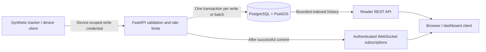

# MicroTransit API — Portfolio Edition

A standalone, sanitized edition of the GPS ingestion and live-update backend from my MicroTransit project. It demonstrates **FastAPI, asynchronous SQLAlchemy, PostgreSQL/PostGIS, device authentication, transactional writes and WebSockets** with generated demo data.

The companion [Next.js frontend](https://github.com/alecke04/microtransit-frontend) illustrates the browser side of the original system: initial GPS history over REST, followed by live updates over WebSockets.

This portfolio edition has fresh Git history and its own CI. It is not the deployed transit service. Operational GPS recordings, production credentials, route geometry/calibration assets, ETA/trip-planning services, firmware provisioning files and deployment account configuration are excluded. The original deployment remains private. The browser frontend needs the authenticated WebSocket handshake described below to connect to this edition.

## Architecture



- Each device has a separate write credential. Reader credentials cannot write, and a device cannot impersonate another configured device.
- Location and heartbeat timestamps have database uniqueness constraints. A duplicate returns `409`, so an interrupted client can check history before retrying.
- Location batches are atomic. A failed point rolls back the entire batch.
- History uses a `(device_id, timestamp)` index, newest first, and a maximum page size of 1,000.
- WebSocket connections require first-message authentication, exact browser origins and bounded global/per-IP capacity. Pending authentication does not receive updates. Failed or slow subscribers are removed without undoing committed data.
- Request bodies are capped at 64 KiB, point batches at 100, and identifiers/numbers/telemetry strings are validated. Credentials are redacted from validation responses and settings representations.

## Run the synthetic demo

Use Python 3.12 and Docker with Compose. Run these commands from the repository root:

```sh
python -m venv .venv
# Activate .venv using the command for your shell.
python -m pip install -r requirements-dev.txt
python -m scripts.setup_demo
docker compose up -d db
python -m scripts.bootstrap_db
uvicorn main:app --host 127.0.0.1 --port 8000 --workers 1 --ws-max-size 1024 --ws-max-queue 4 --limit-concurrency 128 --timeout-keep-alive 5 --no-proxy-headers
```

In a second terminal with the same environment:

```sh
python -m scripts.send_synthetic_demo
```

The setup command creates random reader, device and local database credentials in an ignored `.env` file. It refuses to overwrite an existing file. The database binds only to loopback on port 55439. Bootstrap accepts only the local `portfolio_demo` database. The demo sender contacts only `127.0.0.1:8000` and generates an artificial circle near `(0, 0)`; it contains no recorded trips.

Open [local API documentation](http://127.0.0.1:8000/docs). Read the credentials from your own `.env` privately when using the local API; never put them in URLs, screenshots, public frontend variables or Git.

## Endpoints

| Method / path | Access | Purpose |
| --- | --- | --- |
| `GET /health` | Public | Basic service status |
| `POST /api/devices` | Matching configured device key | Register that device, storing a SHA-256 digest |
| `POST /api/locations` | Matching device key | Save and broadcast one validated GPS point |
| `POST /api/locations/batch` | Matching device key | Save up to 100 points atomically |
| `GET /api/locations/{device_id}?limit=100&start=...&end=...` | Reader key | Bounded GPS history |
| `POST /api/heartbeats` | Matching device key | Save device/network health |
| `GET /api/heartbeats/{device_id}/history?limit=100` | Reader key | Bounded health history |
| `WS /ws/{device_id}` | First-message reader authentication | Live GPS updates |

HTTP credentials use `X-API-Key`. For a WebSocket, send an initial JSON message with `type` set to `auth` and `api_key` set to your local reader credential. Wait for the `authenticated` response before consuming `location_update` events. Respond to a `ping` message with the text `pong`. Secrets in query parameters are not accepted as authentication.

## Verification

```sh
python -m ruff check .
python -m ruff format --check .
python -m pytest -q
python -m pip_audit --strict
```

Without `TEST_DATABASE_URL`, local pytest skips the four PostGIS integration cases and runs the unit/API/security tests. GitHub CI supplies an isolated `portfolio_test` PostGIS service and runs the complete suite, including persisted GPS/heartbeat round trips, live socket delivery, duplicate recovery, atomic batch rollback and an indexed query over 10,000 synthetic points. Integration setup refuses databases with other names or non-loopback hosts.

See [security boundaries](SECURITY.md) and the [publication review](docs/PUBLICATION.md). This repository provides source for portfolio review; no open-source license is granted.
